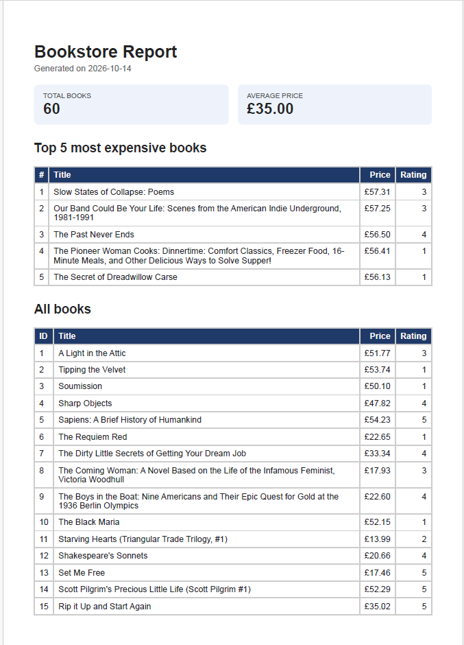

# PDF Report Generator 

A small Express API that turns a SQLite table into a real PDF report. One SQL pass shapes the data, an HTML template is printed to PDF by headless Chromium (Playwright), the file is saved to disk, and the API hands it out by link.

**Pipeline:** query → render → store → serve

## Dataset

Option B, the bookstore: the 60 validated books scraped from books.toscrape.com by my A9 Polite Scraper (`books.json`, same repo). The seed script loads them into a `books` table in `report.db`.

## How to run

Requires Node.js 22+ (uses the built-in `node:sqlite`).

```bash
   git clone https://github.com/ernestmwangombe/ethical-web-scraper-pipeline.git
cd pdf-report-generator
npm install
npx playwright install chromium
npm run seed      # creates report.db and loads 60 books (safe to run twice)
npm start         # API on http://localhost:3000
```

Then, in a second terminal (on Windows PowerShell use `curl.exe`):

```bash
curl -i -X POST http://localhost:3000/reports          # generate (or return today's report)
curl http://localhost:3000/reports/1                    # report record
curl -o report.pdf http://localhost:3000/reports/1/file # download the PDF
```

| Endpoint | Purpose |
|---|---|
| `GET /health` | Returns `{ "status": "ok" }` |
| `POST /reports` | Generates a report: `201` + id + link, or `200` + today's existing report. Body `{ "force": true }` always makes a new one |
| `GET /reports/:id` | The report record and its file link, `404` if unknown |
| `GET /reports/:id/file` | Serves the PDF from disk |

## Aggregation SQL

```sql
-- 1. Total number of books
SELECT COUNT(*) AS total_books FROM books;

-- 2. Average price
SELECT ROUND(AVG(price), 2) AS average_price FROM books;

-- 3. Top 5 most expensive books
SELECT title, price, rating, url FROM books ORDER BY price DESC, title ASC LIMIT 5;

-- 4. Number of books per star rating
SELECT rating, COUNT(*) AS count FROM books GROUP BY rating ORDER BY rating ASC;
```

## Proof: POST → download

```
$ time curl -i -X POST http://localhost:3000/reports
HTTP/1.1 201 Created
{"id":1,"file":"/reports/1/file"}
(took about 2.6 seconds)

$ curl http://localhost:3000/reports/1
{"id":1,"path":"reports/1.pdf","created_at":"2026-10-14T23:01:13.643Z","file":"/reports/1/file"}

$ curl http://localhost:3000/reports/99999
HTTP/1.1 404 Not Found
{"error":"Report not found"}

$ curl -o my-report.pdf http://localhost:3000/reports/1/file
(67,762 bytes, opens as a 3-page PDF of all 60 books with a repeating table header)
```

## Proof: double-click makes one report

Two POSTs fired at the same moment:

```
{"id":1,"file":"/reports/1/file"} -> HTTP 201
{"id":1,"file":"/reports/1/file"} -> HTTP 200
```

Both carry id 1, and `reports/` went from 0 to exactly 1 PDF. A later POST returned id 1 with `200`, and `{ "force": true }` returned a new id 2 with `201` (2 PDFs).

## Stage 4: when would I move this work out of the request?

Generating a report with 60 books typically takes about 2.6 seconds, which is acceptable for single-user scenarios. If report generation time increases beyond a few seconds (such as with thousands of rows or multiple concurrent users) or approaches the standard 30-second timeout, the process should be handled asynchronously: this would immediately return a 202 Accepted status, and a background job would generate the PDF.

## Stage 5: what the duplicate check does

HEAD
This safeguard ensures that if a user double-clicks the button, only one report is generated per day (UTC), unless force is used. Any subsequent request on the same day returns the existing report (200, using the same ID and link), even if the initial report is still processing. Without this protection, duplicate paid actions (like customer billing) could occur, resulting in unnecessary charges and eroding user trust.


This safeguard ensures that if a user double-clicks the button, only one report is generated per request. Any subsequent request on the same day returns the existing report (200, using the same ID and link), even if the initial report is still processing. Without this protection, duplicate paid actions (like customer billing) could occur, resulting in unnecessary charges and eroding user trust.
02731b29013edb427ec903cc69b55de8c6c10146
## Screenshot: page 1 of a generated PDF

